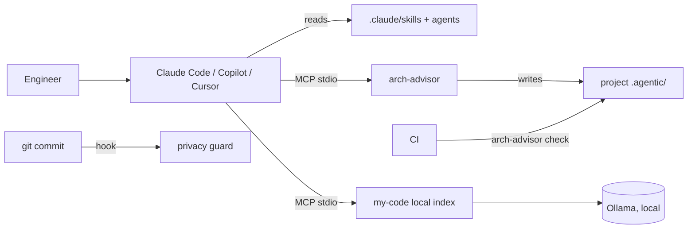

# Architecture

## Style and why
Clean Architecture in miniature (see ADR-0001). `ArchAdvisor.Core` holds all rules as pure, dependency-free C#. `ArchAdvisor.Mcp` is a thin adapter that exposes them as MCP tools over stdio and as a CLI. Skills, subagents and Python tools sit beside it as plain files.

## Context

## Modules and boundaries
| Module | Owns | May call |
|---|---|---|
| `ArchAdvisor.Core` | traits, reference catalogue, advisor rules, ADR rendering, `.agentic/` scaffold, readiness checks, stack detection | nothing (BCL only) |
| `ArchAdvisor.Mcp` | JSON-RPC/MCP protocol, tool schemas, CLI, file system writes | Core |
| `tools/` | privacy guard, Claude Code hook, project generator | git, arch-advisor CLI |
| `local-llm/` | code index, MCP server | Ollama HTTP (localhost) |

## Cross-cutting
- MCP: stdout carries the protocol only; logs go to stderr.
- File writes are confined to the given project root (path-escape check in `DiskProjectFiles`).
- Deterministic output: no clocks or randomness in Core (dates are injected).
