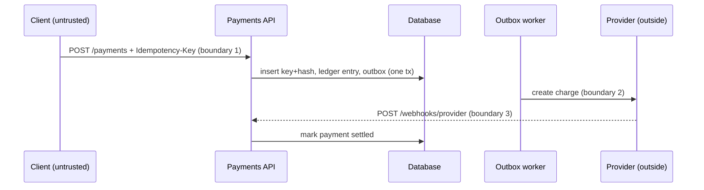

# Threat model

A threat model is a list of ways the design can be abused, each with an owner, a fix and a test. If a threat has no test, it is a hope, not a mitigation.

## Inputs
`docs/DESIGN.md` (section 6, communication flows; section 7, data flow), `.agentic/architecture.md`, the ADRs, and the endpoint list from the code.

## Steps
1. **List the flows.** One row per sequence diagram in DESIGN.md section 6. Add any flow that crosses the internet, a queue or a third party and has no diagram yet (draw it first).
2. **Draw the trust boundaries.** Mark every arrow that crosses one: browser to API, API to database, API to outside provider, webhook in, worker to queue, admin tool to production, AI model call. Data that crosses a boundary inward is untrusted until validated.
3. **Run STRIDE on every boundary-crossing step**, not on the system as a whole:

| Letter | Ask | Typical fix |
|---|---|---|
| **S**poofing | Can someone pretend to be this caller? | AuthN, signed webhooks, mTLS |
| **T**ampering | Can the message or stored data be changed? | Server-side validation, HMAC, row versions |
| **R**epudiation | Can someone deny they did it? | Append-only audit log with actor and time |
| **I**nformation disclosure | Can someone read what they shouldn't? | Object-level authZ, tenant filter, no personal data in logs |
| **D**enial of service | Can someone exhaust it? | Rate limits, timeouts, size limits, queues |
| **E**levation of privilege | Can someone do more than their role allows? | Policy checks per action, least privilege |

4. **Write abuse cases** in user-story form: "As a signed-in customer, I change the account ID in the URL to read another customer's statement." One per realistic attacker (anonymous user, signed-in user, other tenant, insider, compromised dependency, prompt-injected agent).
5. **Score and assign.** Likelihood and impact each 1 (low) to 3 (high). Score = L x I. 6 or more blocks release until mitigated or a human accepts the risk in an ADR.
6. **Link each mitigation to a test.** Name the test file and method, or the grep, or the CI gate. Write the missing tests as failing tests in the next slice.
7. **Write it down** (see "Where it goes"), and revisit when a flow, a boundary or a dependency changes.

## Risk table format
| ID | Flow / step | STRIDE | Threat | L | I | Score | Owner | Mitigation | Test that proves it |
|---|---|---|---|---|---|---|---|---|---|

Owner is a role (payments module lead, platform), never "the team".

## Where it goes
- `docs/THREAT-MODEL.md`: flows, boundary diagram, STRIDE notes per step, abuse cases, the full risk table, accepted risks with the ADR that accepted them, and the date of last review.
- `docs/DESIGN.md` section 11 (Security and privacy): a short **Threat highlights** list with the top five risks by score and a link to `docs/THREAT-MODEL.md`.
- `.agentic/quality.md`: the security tests that must stay green.
- `.agentic/backlog.md`: one item per unmitigated risk.

## Worked mini example: idempotent payment endpoint
Flow: `POST /payments` with an `Idempotency-Key` header. The API stores the key and the request hash, writes a ledger entry and an outbox message in one transaction; a worker calls the payment provider; the provider calls back on `POST /webhooks/provider`.

| ID | Flow / step | STRIDE | Threat | L | I | Score | Owner | Mitigation | Test that proves it |
|---|---|---|---|---|---|---|---|---|---|
| T1 | 1: POST /payments | T | Same key replayed with a different amount to get the first (smaller) result approved for a larger charge | 2 | 3 | 6 | Payments lead | Store a hash of the request body with the key; same key + different hash returns 422 | `PaymentsApiTests.Same_key_different_body_returns_422` |
| T2 | 1: POST /payments | E/I | Caller pays from an account they don't own by changing `accountId` | 2 | 3 | 6 | Payments lead | Load the account with the caller's subject and tenant in the query; 404 if not theirs | `PaymentsApiTests.Paying_from_other_customers_account_returns_404` |
| T3 | 1: POST /payments | D | Flood of unique keys fills the idempotency table | 2 | 2 | 4 | Platform | Rate limit per caller; keys expire after 24 h; key length capped at 64 | `RateLimitTests.Sixty_first_request_in_a_minute_returns_429` |
| T4 | 1: two parallel requests | T | Two requests with the same key race and charge twice | 2 | 3 | 6 | Payments lead | Unique index on (tenant, key); the loser waits and returns the stored result | `PaymentsApiTests.Parallel_same_key_creates_one_ledger_entry` |
| T5 | 3: webhook | S | Forged webhook marks an unpaid payment as settled | 2 | 3 | 6 | Payments lead | Verify the provider's HMAC signature and timestamp (5 min window) before parsing | `WebhookTests.Unsigned_or_stale_webhook_returns_401` |
| T6 | 3: webhook | T | Provider retries the same event; payment settled twice | 3 | 2 | 6 | Payments lead | Store the provider event ID with a unique index; duplicates return 200 and do nothing | `WebhookTests.Duplicate_event_is_a_no_op` |
| T7 | all | R | Customer disputes a payment; no record of who asked | 1 | 2 | 2 | Payments lead | Append-only ledger with actor, key, time; no updates or deletes | `LedgerTests.Ledger_rejects_update_and_delete` |
| T8 | all | I | Card or account numbers end up in logs | 2 | 2 | 4 | Platform | Log payment ID only; log scrubbing test | `grep -rnE "Log.*(CardNumber|AccountNumber)" src/` returns nothing |

Abuse cases for this flow: replay with a changed body (T1), pay from someone else's account (T2), forged settlement (T5), double settlement by retry (T6).

## Done when
Every flow in DESIGN.md has STRIDE notes, every risk scoring 6 or more has a passing test or an accepting ADR, and DESIGN.md section 11 links to `docs/THREAT-MODEL.md`.
